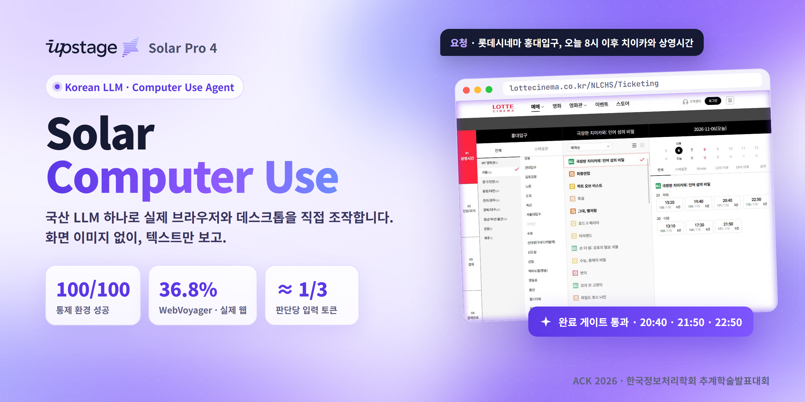
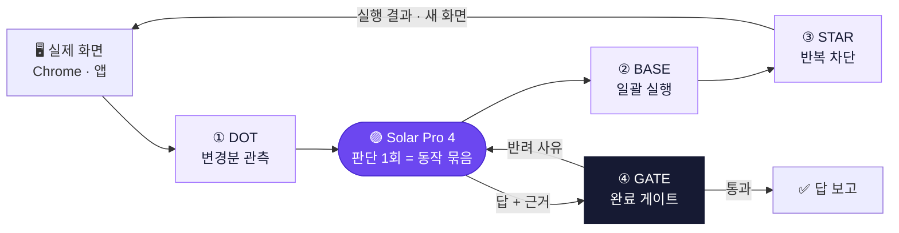
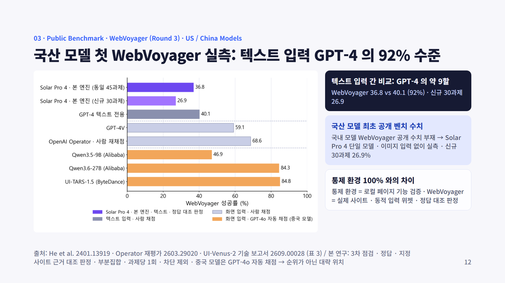
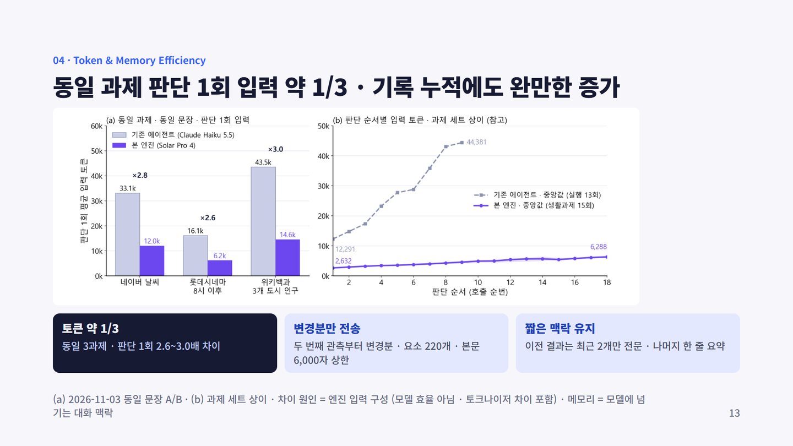
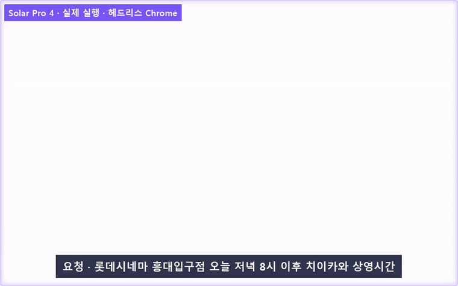

  

  
  
  
  

  <b>국산 LLM 하나로 실제 브라우저와 데스크톱을 직접 조작하는 컴퓨터 유즈 에이전트</b> 
  A computer-use agent that drives real browsers and desktops with a single Korean LLM, Upstage Solar Pro 4, from text alone.

  <a href="https://solar-cua-demo.vercel.app"><b>▶ 실행 기록 재생 데모</b></a>
  &nbsp;·&nbsp;
  <a href="#results"><b>결과</b></a>
  &nbsp;·&nbsp;
  <a href="#method"><b>알고리즘</b></a>

 

<table align="center">
  <tr>
    <td align="center" width="33%"><h3>100 / 100</h3>통제 환경 5과제 × 20회 실패 0 · 95% CI 96.3–100%</td>
    <td align="center" width="33%"><h3>36.8%</h3>WebVoyager · 실제 웹사이트 이미지 없이 GPT-4 텍스트 입력의 92%</td>
    <td align="center" width="33%"><h3>≈ 1/3</h3>판단 1회당 입력 토큰 동일 과제 기존 에이전트 대비</td>
  </tr>
</table>

 

해외 AI 에이전트는 이미 정부24, 홈택스, 나이스, RISS 같은 한국 기관 사이트에 접속하고 있습니다. 그런데 이 일을 맡길 수 있는 **국산 컴퓨터 유즈 모델은 아직 없습니다.**

Solar Computer Use는 **Upstage Solar Pro 4 단일 모델**만으로 실제 웹과 데스크톱을 조작합니다.

- 🇰🇷 **국산 모델 단일 구성**: 모든 판단은 Solar Pro 4가 내립니다. 해외 모델로 넘기는 경로가 없습니다.
- 📝 **텍스트만으로**: 스크린샷 대신 화면 요소 목록을 읽고 움직입니다.
- 🧩 **함수 호출로만 행동**: 모델은 정해진 동작을 함수 호출로 고를 뿐, 임의 코드를 실행하지 않습니다.
- ✅ **근거 기반 완료 판정**: "다 했다"는 모델의 말이 아니라, 실제로 관측한 근거로 판정합니다.

 

같은 Solar Pro 4라도 **실행 구조에 따라 결과가 크게 달랐습니다.** 그래서 모델은 그대로 두고 실행 루프를 네 가지 알고리즘으로 다시 설계했습니다.

| | 알고리즘 | 하는 일 |
|:-:|---|---|
| **①** | **DOT** · Delta Observation with stable Tags | 화면 요소에 번호를 붙이고, 두 번째 관측부터는 **바뀐 부분만** 모델에 전달 |
| **②** | **BASE** · Batched Actions with Stop on Emergence | 동작 여러 개를 한 번에 실행하되, **새 입력 칸·추천 목록·선택 창이 뜨면 멈추고** 다시 판단 |
| **③** | **STAR** · STate–Action Repeat guard | 같은 화면에서 같은 행동을 되풀이하지 않도록 차단 |
| **④** | **GATE** · Grounded Answer & Task-condition Evaluation | 모델의 "완료" 선언을 그대로 믿지 않고, **관측한 근거와 과제 조건**(예: "8시 이후")을 호스트가 직접 대조 |

 

### 통제 환경 · 100 / 100

로컬 과제 페이지 5종을 각각 20회 연속 실행했습니다. 정답은 Solar의 답을 믿지 않고 **서버가 실제로 받은 값·같은 순간의 공식 API 값**과 대조했습니다.

| 과제 | 성공 | 시간 (중앙값) | 판단 (중앙값) |
|---|:-:|:-:|:-:|
| 위키백과 검색 → 읽기 | 20 / 20 | 10.6초 | 2 |
| Hacker News 1위 글 제목 · 점수 | 20 / 20 | 6.5초 | 1 |
| 7칸 신청서 (칸 동적 추가) | 20 / 20 | 16.9초 | 3 |
| 로그인 후 등급 읽기 | 20 / 20 | 10.3초 | 2 |
| 9칸 주문서 제출 | 20 / 20 | 19.2초 | 3 |
| **합계** | **100 / 100** | | |

### 실제 웹 · WebVoyager

국내 모델로 WebVoyager를 잰 공개 수치는 없었습니다. Solar Pro 4 하나로, **이미지 입력 없이** 실측했습니다.

- **36.8%**: GPT-4 텍스트 입력(40.1%)의 **92% 수준**
- **26.9%**: 개발에 쓰지 않은 **신규 30과제**에서도 비슷한 수준

### 효율 · 판단당 입력 약 1/3

같은 문장으로 같은 과제를 돌린 A/B에서 판단 1회당 입력 토큰이 기존 에이전트보다 **2.6–3.0배 적었습니다.** 두 번째 관측부터 바뀐 줄만 보내고, 이전 결과는 최근 2개만 전문으로 두기 때문입니다.

 

> **요청** · 롯데시네마 홍대입구점, 오늘 저녁 8시 이후 치이카와 상영시간

Solar가 사이트에 들어가 영화관과 영화를 고르고 시간표를 읽습니다. 첫 답은 **완료 게이트가 반려**(후보 시각 목록 요구)했고, 다시 제출한 답이 통과했습니다. 8시 이전인 19:40은 빠졌습니다.

  <a href="https://solar-cua-demo.vercel.app"><b>▶ 다른 실행 기록도 재생해 보기</b></a>

 

## 🎤 발표

**Solar Computer Use: Upstage Solar 기반 웹 · OS 통합 제어와 근거 기반 실행 검증** 
한국정보처리학회 ACK 2026 추계학술발표대회 · S4. 인공지능 · 학부생 논문경진대회 구두 발표

<b>측정 조건</b>

 

- 통제 환경: 2026-11-05, 헤드리스 Chrome, 로컬 과제 페이지, 과제별 20회 연속. 시간은 Chrome 실행을 포함한 벽시계 중앙값, 판단은 Solar 호출 수 중앙값.
- WebVoyager: 3차 점검, 부분집합, 과제당 1회, 사이트 차단 과제 제외. 공식 자동 평가기 대신 과제 정답과 지정 사이트 근거를 실행 기록과 대조해 판정. 비교 수치는 He et al. (arXiv 2401.13919)의 텍스트 입력 GPT-4.
- 토큰: 2026-11-03 동일 문장 A/B, 동일 3과제. 차이는 모델이 아니라 엔진이 보내는 입력 구성에서 나오며, 토크나이저 차이를 포함.

 

## 📌 이 저장소에 대하여

이 저장소는 **프로젝트 소개용**입니다. 실행 엔진과 알고리즘 구현 코드는 포함하지 않습니다.

  © 2026 Jaemin Jo · Built on <a href="https://www.upstage.ai">Upstage Solar</a>. Upstage and Solar are trademarks of Upstage.

